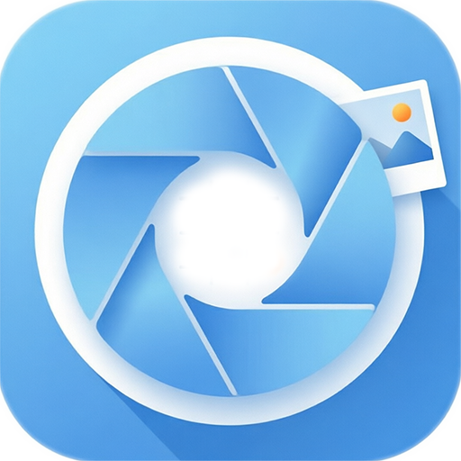
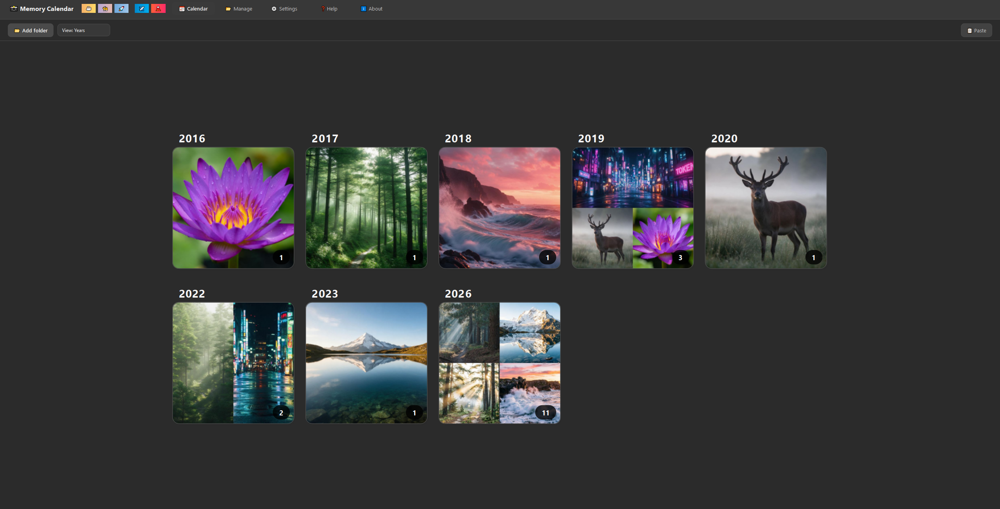
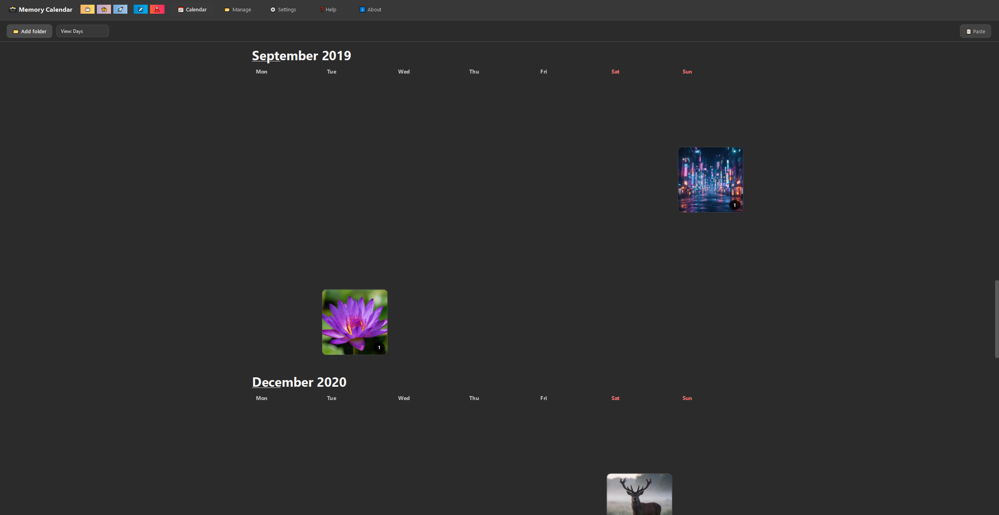
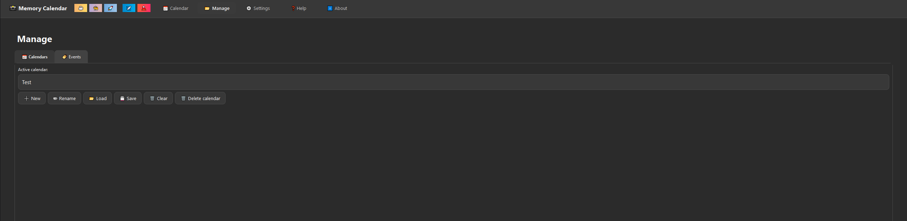
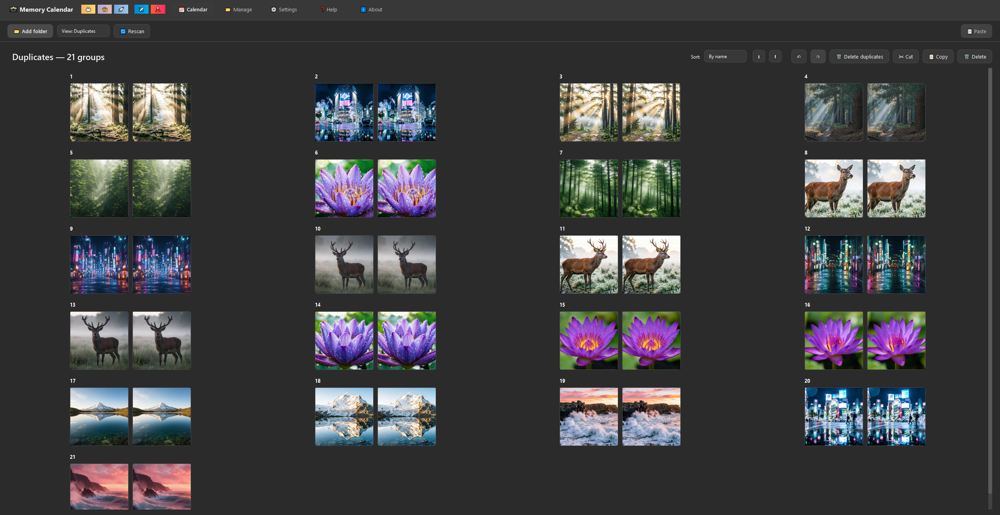
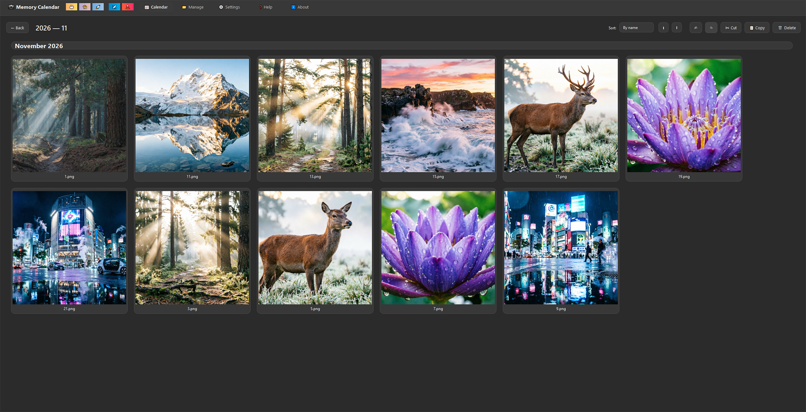
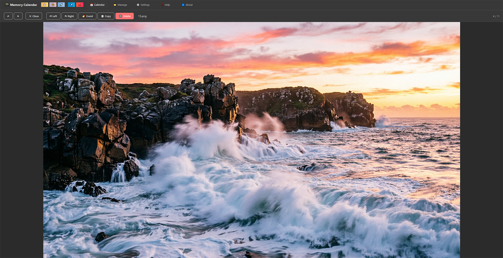
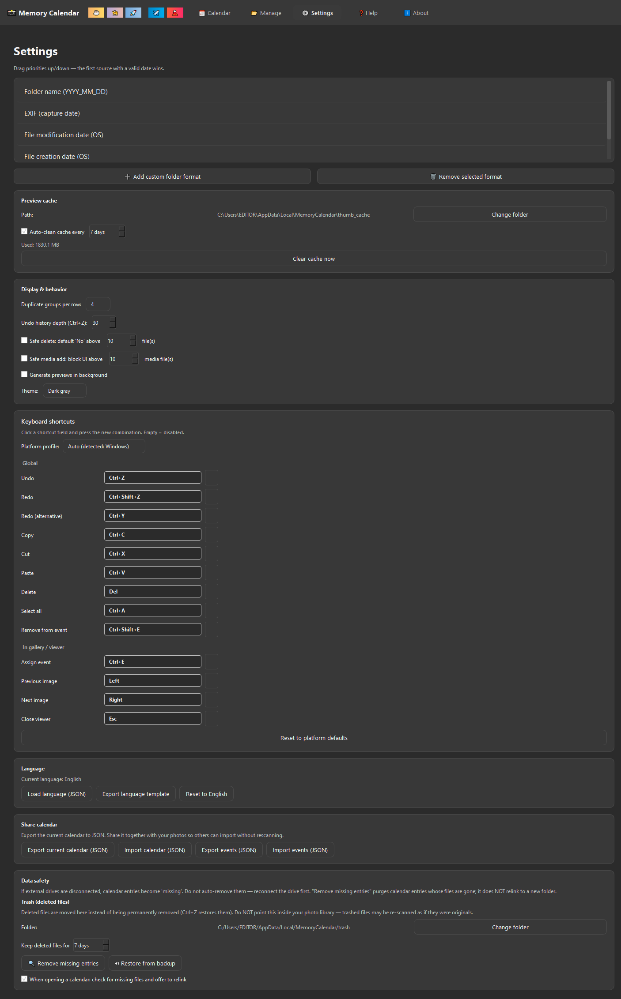

<html lang="en">
<head>
    <meta charset="UTF-8">
    <meta name="viewport" content="width=device-width, initial-scale=1.0">
    <title>Memory Calendar: The Free, Private Photo Organizer</title>
    <link rel="preconnect" href="https://fonts.googleapis.com">
    <link rel="preconnect" href="https://fonts.gstatic.com" crossorigin>
    <link href="https://fonts.googleapis.com/css2?family=Inter:wght@400;500;600;700;800&display=swap" rel="stylesheet">
    
    <!-- SEO Скрипт для ИИ и поисковиков -->
    

    
</head>
<body>

    

        <!-- Кнопка Назад -->
        

            <a href="./index.html">← Back to Home</a>
        

      <h1>
    
    Memory Calendar: The Free, Private Photo Organizer
</h1>

        

            <strong>Quick Answer:</strong> Memory Calendar is a free, open-source, and completely offline desktop application for Windows, macOS, and Linux. It acts as both a powerful <strong>photo organizer</strong> and a <strong>photo viewer</strong> that automatically sorts your media library into a visual calendar (Days, Months, Years) using EXIF data or folder names. It also features safe duplicate detection and virtual "Events" without duplicating any data.
        

        <!-- Картинка 1 -->
        

            
            
Click on any image to view it in full size

        

        
Every one of us has that folder—the "Photos" folder that starts organized and quickly turns into a chaotic dumping ground of screenshots, camera uploads, and saved images. Cloud services offer solutions, but they often come with subscription fees, compressed quality, and legitimate privacy concerns.

        
If you are looking for a <strong>free photo organizer</strong> or a fast <strong>photo viewer for Windows</strong> that can handle large libraries, <strong>Memory Calendar</strong> is worth your attention. It is a local desktop application that transforms your file chaos into a clean, navigable calendar.

        <h2>📅 A Calendar for Your Life: 5 View Modes</h2>
        
Instead of a boring list of folders, Memory Calendar offers a visual approach. It scans your library and automatically distributes files by date across several viewing modes:

        <ul>
            <li><strong>Days:</strong> A classic grid where each day of the month is a card with a thumbnail preview.</li>
            <li><strong>Months:</strong> A quick overview of all months in a year.</li>
            <li><strong>Years:</strong> A global view—instantly see which years produced the most photos.</li>
            <li><strong>Events:</strong> Virtual albums (explained below).</li>
            <li><strong>Duplicates:</strong> A dedicated mode for cleaning up your disk.</li>
        </ul>
        
The interface supports zooming (hold <code>Ctrl</code> + mouse wheel), allowing you to switch between a high-level yearly overview and a detailed look at a single day in seconds.

        <!-- Картинка 2 -->
        

            
        

        <h2>🗂 Events: Virtual Albums That Take Up Zero Disk Space</h2>
        
One of the most powerful features is the <strong>Events</strong> mode. Often, photos from the same vacation or family gathering are scattered across different folders or even different devices.

        
In Memory Calendar, you can create multiple calendars (for example, import your phone photos into a calendar called <code>smartphoneStory</code> and your camera photos into <code>cameraStory</code>). Then, you can combine them into a single "Event" (e.g., "Vacation 2024" or "Friend's Wedding").

        
The key advantage is that <strong>this is a virtual grouping</strong>. The application does not create physical copies or duplicate files, saving your disk space. When it's time to share memories, you can <strong>export all media files from an Event to any folder</strong> on your computer with one click.

        <!-- Картинка 3 -->
        

            
        

        <h2>🔍 Duplicate Detection and Safe Deletion</h2>
        
You likely have photos that were downloaded twice. Memory Calendar finds exact duplicates using smart algorithms (full SHA-256 hashing for videos and smart sampling for large photos).

        
More importantly, the app prioritizes <strong>safety</strong> with its "Safe delete" concept:

        <ol>
            <li>When you delete a file, it is not permanently erased. It is moved to the app's dedicated <strong>Trash</strong> folder.</li>
            <li>You can press <code>Ctrl+Z</code> at any time to undo the action (the undo history depth is configurable up to 200 steps).</li>
            <li>Deleted files are kept in the trash for a configurable period (from 7 to 365 days) and are automatically cleaned up only after that period expires.</li>
        </ol>

        <!-- Картинка 4 -->
        

            
        

        <h2>🧠 How Does It Know the Dates? (Smart Sorting)</h2>
        
To sort photos by date, Memory Calendar needs to determine when they were taken. In the settings, you can flexibly prioritize the sources of date information:

        <ol>
            <li><strong>Folder Name:</strong> The app can recognize dates directly from folder names (e.g., <code>2023_10_15</code>). You can even create your own custom formats.</li>
            <li><strong>EXIF:</strong> The classic metadata embedded in the photo by the camera.</li>
            <li><strong>OS Modified Date:</strong> When the file was last edited.</li>
            <li><strong>OS Created Date:</strong> When the file appeared on the disk.</li>
        </ol>
        
You can drag and drop these options in the settings to build your own sorting logic.

        <h2>🛡 Safety and Recovery of Lost Files</h2>
        
What happens if you move a photo folder to a new location and Memory Calendar "loses" the files? Instead of simply clearing the list, the application offers to help you <strong>find lost files (Relink)</strong>. You select the new folder, and the app reconnects the files to your library by matching their names.

        
The app also has a built-in backup system. The calendar state is saved atomically, and if the file count drops sharply (for example, you accidentally disconnect an external drive), the application will automatically create a backup of your data.

        <h2>🎨 Customization and Advanced Features</h2>
        <ul>
            <li><strong>Background thumbnail generation:</strong> Smooth performance even with huge libraries.</li>
            <li><strong>Full-featured viewer:</strong> The built-in viewer supports zoom, panning, and <strong>photo rotation</strong> (while preserving EXIF data).</li>
            <li><strong>Customizable hotkeys:</strong> Don't like the standard <code>Ctrl+C</code>? Rebind any combination.</li>
            <li><strong>Data export:</strong> You can export your calendar or event list to JSON.</li>
            <li><strong>Themes:</strong> Choose between a Light and a Dark Gray theme.</li>
        </ul>

        <!-- Картинки 5, 6, 7 -->
        

            
        

        

            
        

        

            
        

        <h2>💻 Technical Details and Privacy</h2>
        
The application is written entirely in <strong>Python</strong> using <strong>PySide6 (Qt 6)</strong>, along with the Pillow and OpenCV libraries for media handling.

        <ul>
            <li><strong>No clouds:</strong> Your photos never leave your computer.</li>
            <li><strong>No telemetry:</strong> No one tracks your actions.</li>
            <li><strong>Format:</strong> Supports JPG, PNG, HEIC/HEIF, WEBP, TIFF, and video (MP4, MOV, AVI).</li>
        </ul>

        <h2>❓ Frequently Asked Questions (FAQ)</h2>
        
        

            
Is Memory Calendar really free?

            
Yes, Memory Calendar is completely free for personal use and organizations with 10 or fewer employees. It is distributed under the Business Source License (BSL 1.1).

        

        

            
Does it work on Mac or Linux?

            
Yes. The application is stable on Windows, and BETA versions are available for macOS and Linux.

        

        

            
Will it delete my photos permanently?

            
No. The app uses a "Safe delete" system. Deleted files are moved to a dedicated Trash folder and can be restored with <code>Ctrl+Z</code> or from the folder itself within the retention period (7–365 days).

        

        <h2>💎 The Verdict</h2>
        
<strong>Memory Calendar</strong> is an excellent example of how a focused tool can solve a specific problem (organizing photos by date) far better than bloated all-in-one suites.

        
If you value privacy, are tired of cloud subscriptions, and want a convenient way to browse your family photo archive—neatly sorted and organized—give this project a try.

        <a href="https://github.com/TinoMakesDev/memory-calendar" target="_blank" class="btn">
            Download on GitHub
        </a>

    

</body>
</html>
